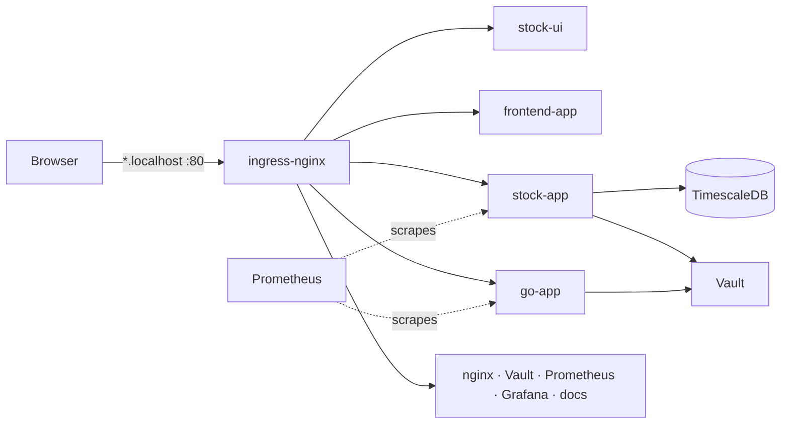

# Design

## Traffic

Everything from your machine enters through ingress-nginx on host port 80 and is routed by host name
(`<component>.localhost`) to the component's Service. The frontends call the backends cross-origin;
the backend Ingresses enable CORS. Metrics stay inside the cluster.

## Decisions

- **Ownership:** a resource owned by one component lives in `<component>/k8s/`; cluster-wide resources
  (kind config, namespaces, RBAC) live in `platform/` and are applied first.
- **Namespaces:** `apps` (stock-app, go-app, frontend-app, stock-ui, nginx), `monitoring`, `vault`, `data`
  (TimescaleDB), `docs`. Every manifest sets its namespace; cross-namespace calls use `<service>.<namespace>`.
- **Least privilege:** each workload has its own ServiceAccount with no API token. Only Prometheus gets
  read-only API access, for service discovery.
- **Metrics discovery:** a Service is scraped when annotated `prometheus.io/scrape: "true"` and
  `prometheus.io/job: <name>`, so new services need no Prometheus change.
- **Secrets:** dev credentials live in one Secret per tool. Secrets can't cross namespaces, so the Vault token
  and the database password are declared in both namespaces that need them. Vault (dev mode) holds app secrets,
  one path per service (`services/<service>/`).
- **Stateful data:** TimescaleDB uses a PVC; it is empty after every `./recreate-cluster.sh`, which is fine
  because stock-app refills it from the provider.
- **API contract:** stock-app's `openapi.yaml` is the source of truth; its models are generated from it.

## Conventions

- Deployment and `app` label = component name; Service `<component>-service`; Ingress `<component>-ingress`.
- Every workload has requests/limits and a readiness probe; own images run as non-root; images are pinned.
- `./recreate-cluster.sh` is the single entry point and stays idempotent.
