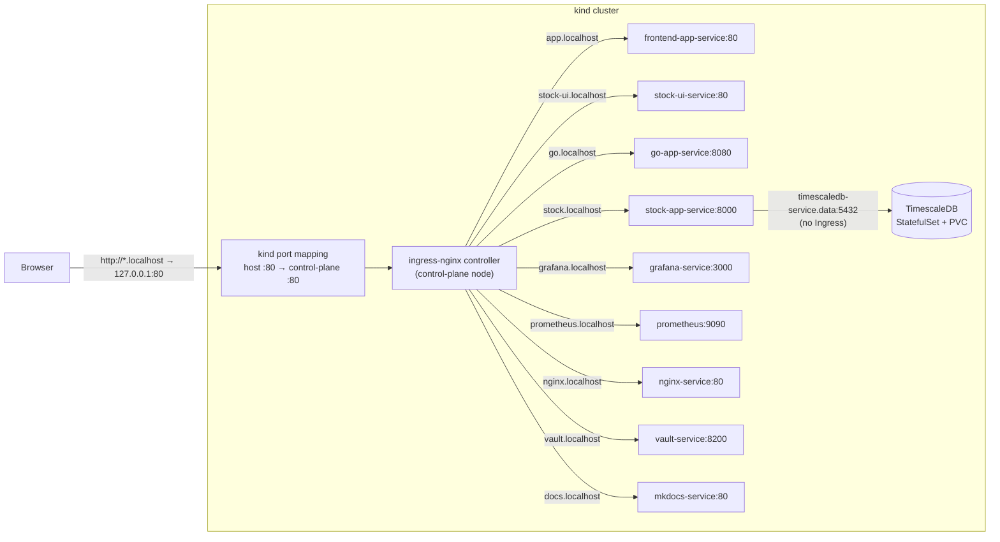
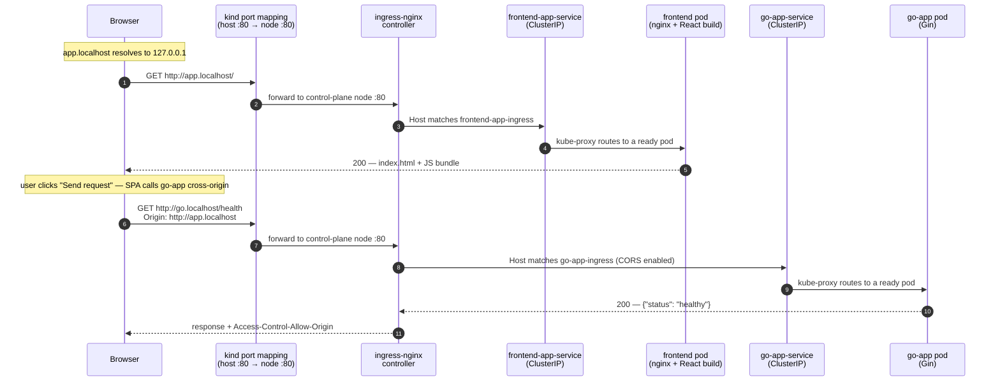

# Architecture Design

## Purpose

A local Kubernetes playground (`kind`, 3 nodes: 1 control-plane, 2 workers) for practicing DevOps workflows: deploying services, exposing metrics, building Grafana dashboards, and observing traffic end-to-end.

## Components

Each component has its own page under [Services](services/index.md), covering
how to redeploy it and how to run it on its own.

| Component | Role | Ingress host |
|---|---|---|
| [`go-app`](services/go-app.md) | Gin sample backend, exposes `/metrics` | http://go.localhost |
| [`stock-app`](services/stock-app.md) | FastAPI market data service (hexagonal), daily OHLCV bars over TimescaleDB | http://stock.localhost |
| [`timescaledb`](services/timescaledb.md) | PostgreSQL 17 + TimescaleDB, StatefulSet backing `stock-app` | in-cluster only (`timescaledb-service.data:5432`) |
| [`nginx`](services/nginx.md) | Standalone sample app, scraped via `nginx-exporter` | http://nginx.localhost |
| [`vault`](services/vault.md) | HashiCorp Vault (dev mode), shared secret store for go-app | http://vault.localhost |
| [`frontend-app`](services/frontend-app.md) | React UI ("API Tester") to trigger requests against stock-app/go-app | http://app.localhost |
| [`stock-ui`](services/stock-ui.md) | React UI ("Stock App") charting stock-app's daily bars | http://stock-ui.localhost |
| [`prometheus`](services/prometheus.md) | Scrapes metrics from all app `/metrics` endpoints + node exporters | http://prometheus.localhost |
| [`grafana`](services/grafana.md) | Dashboards over Prometheus data, provisioned via Ansible | http://grafana.localhost |
| [`documentation`](services/documentation.md) | MkDocs site (this doc) | http://docs.localhost |

## Network Configuration

All host traffic enters through a single entry point: the ingress-nginx controller, published on host port 80. The chain is:

1. `*.localhost` hostnames resolve to loopback (built into browsers, macOS, and systemd-resolved on Linux/CI — no DNS or `/etc/hosts` setup).
2. `platform/kind-cluster.yaml` maps host port 80 to port 80 on the control-plane node, where the ingress-nginx controller runs (`ingress-ready=true` node label).
3. The controller matches the request's `Host` header against the `Ingress` resources (one per component, in each component's `k8s/` directory) and forwards to that component's `ClusterIP` Service.
4. kube-proxy load-balances the Service to a ready pod, which may run on any worker node.

### Routing map

### Life of a sample request

A user opens the frontend and triggers a health check against go-app. Two requests cross the cluster boundary: loading the SPA, then the cross-origin API call the SPA makes from the browser.

- Both React UIs call the backends cross-origin on their own ingress hosts; the go-app and stock-app Ingresses enable CORS (`nginx.ingress.kubernetes.io/enable-cors`).
- Monitoring traffic never leaves the cluster: Prometheus scrapes each app's `/metrics` and Grafana queries Prometheus via in-cluster service DNS.
- The standalone `nginx` component is a sample app monitored via `nginx-exporter` on port 9113.

## Sample Backends (go-app)

Defines the shared endpoint contract any sample backend can implement so the
frontend can target it:
- `GET /` — home
- `GET /health` — health check (also used by each pod's Kubernetes `readinessProbe`)
- `GET /error` — simulated 500
- `GET /redirect` — redirect to `/health`
- `GET /metrics` — Prometheus format
- `POST /secret` — store `{"key", "value"}` in Vault (201, or 502 when Vault fails)
- `GET /secret/{key}` — read a secret from Vault (404 when missing)

go-app stores secrets in the shared dev-mode Vault through its in-cluster
service (`http://vault-service.vault:8200`, configured via `VAULT_ADDR`/`VAULT_TOKEN`
env vars in its Deployment — cross-namespace, hence the `.vault` qualifier). Vault has two KV v2 root paths: `services/`
holds all service secrets with one sub-path per service
(`services/<service>/<key>`, set via `VAULT_SECRET_PATH`), and `infra/` is
reserved for future infrastructure secrets. A future second backend under this
contract would get its own sub-path and would not see go-app's keys; Vault
policies can later scope each service to its own path. See
[Vault](services/vault.md).

## Stock Data Service (stock-app, timescaledb)

`stock-app` is the one component that is a real data service rather than a
traffic sample, and it deliberately does **not** implement the shared backend
contract above — no `/error`, no `/redirect`, no `/secret`. It serves daily
OHLCV bars under `/api/v1`, reading from TimescaleDB and calling an external
market data provider only for windows it has not synced yet.

Its HTTP surface is the only contract-first one in this cluster:
`stock-app/openapi.yaml` is hand-authored, the pydantic request and response
models are generated from it, and the service publishes that file at
`/openapi.json` instead of a document derived from the code. Regeneration drift
and route-to-operation parity both fail the build.

It is also the reference for a layered service in this repository: hexagonal,
with the dependency rule `adapters → application → domain`, ports as
`typing.Protocol`, and `main.py` as the only module that constructs adapters.
TimescaleDB runs as a StatefulSet with a PVC in the `data` namespace and has no
Ingress. See [stock-app](services/stock-app.md) and
[TimescaleDB](services/timescaledb.md).

## Frontends (frontend-app, stock-ui)

Two React single-page apps, each built into an image that serves its bundle
with NGINX, and each calling backends cross-origin on their own ingress hosts
rather than proxying them on its own origin.

They exist for different reasons and neither replaces the other:

- [`frontend-app`](services/frontend-app.md) ("API Tester") is a *traffic* tool
  — pick an endpoint, fire a burst of requests, watch them land on a Grafana
  dashboard.
- [`stock-ui`](services/stock-ui.md) ("Stock App") is a *product* surface —
  search a company, chart its daily bars as a line or candles, hover a session
  to read its prices. It is the only place stock-app's data is presented rather
  than dumped as JSON.

They share one design system — the tokens, primitives and dark/light switch in
`src/styles/theme.css` — so the cluster reads as one product rather than two
unrelated demos. Nothing is shared at build time: each app is its own image
with its own `package.json`, so that stylesheet is duplicated on purpose and
the two copies have to be changed together. A shared package would mean a
workspace, a publish step, or a third image, which is more machinery than two
small SPAs are worth.

stock-ui is deliberately partly mocked: its Portfolio, Watchlist and account
menu are fixed browser-side data, because this cluster has no accounts, no auth
and no portfolio service. The analysis panels under its chart are reserved,
empty slots for indicators nobody has chosen yet. Both are labelled as such on
screen — a market data screen that invents a P/E ratio is worse than one with
an obvious gap.

## Monitoring

Prometheus discovers its targets through the Kubernetes API: any Service
annotated `prometheus.io/scrape: "true"` gets its endpoints scraped on
`/metrics`. Grafana visualizes the data, with datasource and dashboards
provisioned as code via Ansible. See the [Monitoring](monitoring.md) page for
the discovery annotations, exposed metrics, and the dashboard workflow.

## Deployment

- Entry point: `./recreate-cluster.sh` — idempotent, deletes/recreates the `kind` cluster, installs ingress-nginx (pinned Kind manifest), applies `platform/` (Namespaces, cluster-scoped RBAC), builds and loads all Docker images, applies each component's `k8s/` manifests in order (Prometheus → Grafana → NGINX → Vault → TimescaleDB → stock-app → go-app → frontend-app → stock-ui → documentation), then provisions Grafana dashboards via Ansible.
- TimescaleDB is waited for explicitly (`kubectl rollout status statefulset/timescaledb`) before stock-app is applied: stock-app's Alembic initContainer needs a live database, and the readiness loop further down only waits on Deployments, which would skip a StatefulSet.
- Resource placement follows an ownership rule: namespaced resources owned by one service live in that service's `k8s/` directory; resources that outlive any single service (kind config, Namespaces, ClusterRoles/Bindings) live in `platform/`. See [Platform Decisions](platform-decisions.md).
- Each component directory is self-contained: its own `Dockerfile` and `k8s/` manifests (Deployment, Service, Ingress, ServiceAccount). Its documentation is *not* — every component has a page under [Services](services/index.md) and its `README.md` is a stub pointing there, so a fact lives in one place.
- Namespaces: `apps` (go-app, stock-app, frontend-app, stock-ui, nginx), `monitoring` (Prometheus, Grafana, node-exporter), `vault` (Vault + configure Job), `docs` (MkDocs), `data` (TimescaleDB). Every manifest declares its namespace explicitly.
- Every workload runs under its own ServiceAccount with `automountServiceAccountToken: false`. The only exception is Prometheus, which mounts its token for Kubernetes service discovery, scoped by the read-only ClusterRole in `platform/rbac/prometheus.yaml`.
- `platform/kind-cluster.yaml` maps only host port 80 to the control-plane node, where the ingress controller runs (`ingress-ready=true` label).

## Testing

- Unit tests: `make test-unit` — per-service Go (`go test`) and Python (`tox`) suites, auto-discovered (see `adding-a-service.md`).
- End-to-end tests: `make test-e2e` — black-box pytest suite in `e2e/` that exercises the running cluster through the ingress hosts: backend endpoint contract, frontend serving and CORS, and the traffic → Prometheus → Grafana pipeline. Requires the cluster to be up (`./recreate-cluster.sh`); CI runs the full flow in `.github/workflows/e2e.yaml` (see `e2e-tests.md`).
- What to run after a given change (Go/Python/frontend code, K8s manifests, docs, monitoring, Vault, CI, …) is enumerated in [Validation Rules](validation-rules.md).

## Conventions

- All K8s manifests applied idempotently (`kubectl apply`).
- New Go services are auto-discovered by presence of `go.mod`; new Python services by presence of `tox.ini` (see `adding-a-service.md`).
