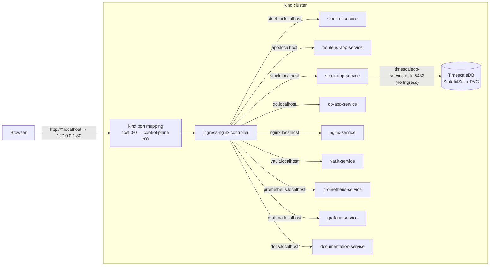
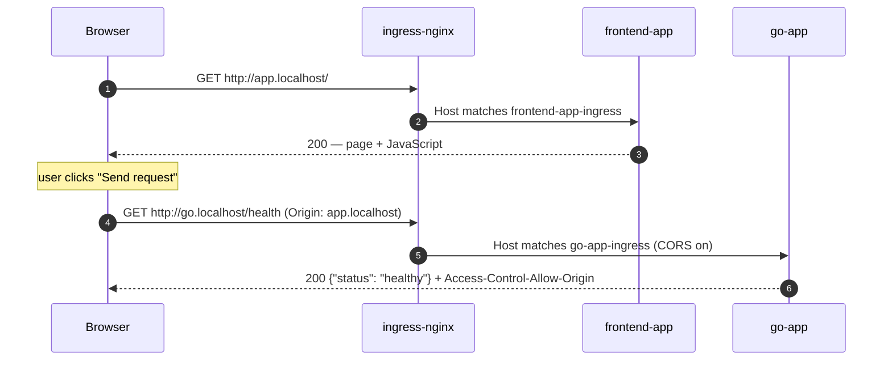

# Design

A local `kind` cluster (1 control-plane node, 2 workers) for practicing platform work:
deploy services, expose metrics, build dashboards, and follow traffic end to end.
The component list is on the [Home](index.md) page.

## How traffic gets in

All traffic from your machine enters through one door: the ingress-nginx controller on port 80.

1. `*.localhost` names resolve to your own machine (127.0.0.1).
2. `platform/kind-cluster.yaml` forwards host port 80 to the control-plane node, where ingress-nginx runs.
3. ingress-nginx reads the `Host` header and picks the matching `Ingress` (one per component, in `<component>/k8s/`).
4. The Ingress sends the request to that component's `ClusterIP` Service, which picks a ready pod.

## Life of a request

The frontend pages load from their own host (`app.localhost`, `stock-ui.localhost`), then call a backend on its host.
That is a cross-origin call, so the backend Ingresses turn on CORS (`nginx.ingress.kubernetes.io/enable-cors`).

Metrics never leave the cluster: Prometheus scrapes each app inside the cluster and
Grafana reads Prometheus inside the cluster. See [Monitoring](services/monitoring.md).

## Backends

### go-app sample contract

go-app is a traffic sample. It answers these endpoints, which frontend-app and the e2e tests drive:

| Endpoint | Answer |
|---|---|
| `GET /` | 200, JSON with a `message` |
| `GET /health` | 200 `{"status": "healthy"}` (also the readiness/liveness probe) |
| `GET /error` | 500 (simulated failure) |
| `GET /redirect` | 302 to `/health` |
| `GET /metrics` | Prometheus metrics |
| `POST /secret` `{"key", "value"}` | 201 stored · 422 invalid input · 502 Vault failed |
| `GET /secret/{key}` | 200 · 404 missing · 502 Vault failed |

Valid key: letters, digits, `_`, `.`, `-`. Value: not empty. Secrets are stored in [Vault](services/vault.md).

### stock-app data service

stock-app serves daily stock prices (OHLCV bars) under `/api/v1`. It reads them from TimescaleDB
and calls an external market data provider only for date windows it has not synced yet (cache-aside).
It also answers `/`, `/health`, `/metrics` and the same `/secret` endpoints as go-app (its own Vault path),
but not `/error` or `/redirect`.

- **Contract-first:** `stock-app/openapi.yaml` is the source of truth. The request/response models are
  generated from it, and the service publishes that file unchanged, as YAML, at `/openapi.yaml`. See [stock-app API](services/stock-app-api.md).
- **Hexagonal:** `adapters → application → domain`, ports are `typing.Protocol`, and `src/main.py` is
  the only place that builds adapters. The import rule is enforced by `lint-imports`.
- **Database:** TimescaleDB runs as a StatefulSet with a PVC in the `data` namespace and has no Ingress.

Details: [stock-app](services/stock-app.md), [TimescaleDB](services/timescaledb.md).

## Frontends

- [frontend-app](services/frontend-app.md) is a **traffic tool**: pick a backend and an endpoint,
  send a burst of requests, watch it land in Grafana.
- [stock-ui](services/stock-ui.md) is a **product page**: search a company and chart its daily prices.
  Its Portfolio, Watchlist and account menu are mocked on purpose (there are no accounts in this cluster).

Both are React + Vite builds served by non-root nginx, and share one look (`src/styles/theme.css`, kept
in sync by hand — each app is its own image).

## Deployment

`./recreate-cluster.sh` deletes and recreates the cluster, installs ingress-nginx (pinned version),
applies `platform/` (namespaces, cluster-wide RBAC), builds and loads the local images, applies every
`<component>/k8s/` directory in order (monitoring → nginx → Vault → TimescaleDB → backends → frontends → docs),
waits for everything, and provisions Grafana with Ansible.

| Namespace | Components |
|---|---|
| `apps` | stock-app, go-app, frontend-app, stock-ui, nginx |
| `monitoring` | Prometheus, node-exporter, Grafana |
| `vault` | Vault and its setup Job |
| `data` | TimescaleDB |
| `docs` | Documentation |

Why it is split this way: [Platform Decisions](platform-decisions.md).

## Conventions

- Names: Deployment and `app` label = component name; Service = `<component>-service`; Ingress = `<component>-ingress`.
- Every manifest sets its `namespace`; cross-namespace calls use `<service>.<namespace>` DNS names.
- Every workload has its own ServiceAccount with no API token mounted (Prometheus is the only exception).
- Every workload has resource requests/limits and a readiness probe; our own images run as non-root.
- Images are pinned to a version (never `:latest`).
- Dev credentials live in one Secret each (`grafana-admin-secret`, `vault-dev-token`, the TimescaleDB password).
