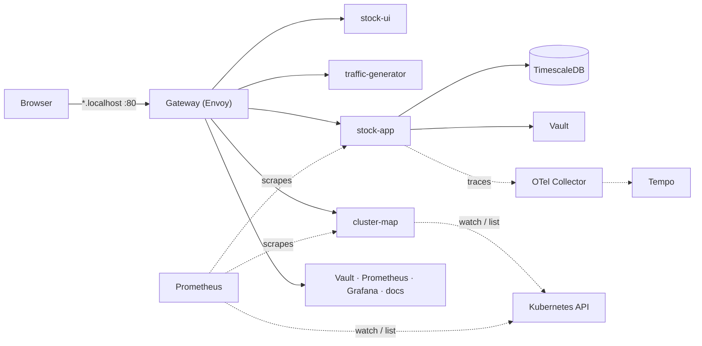

# Design

## Traffic

Everything from your machine enters through one Gateway API Gateway on host port 80 and is routed by host name
(`<component>.localhost`) to the component's Service. The frontends call stock-app cross-origin; stock-app's
HTTPRoute has a CORS filter. Metrics and traces stay inside the cluster. Step by step: [Networking](networking.md).

## Decisions

- **Ownership:** a resource owned by one component lives in `<component>/k8s/`; cluster-wide resources
  (kind config, Gateway API controller and the shared Gateway, namespaces, RBAC) live in `platform/` and are applied
  first.
- **Entry point:** Gateway API, implemented by Envoy Gateway (`platform/envoy-gateway/`), replaced the retired
  ingress-nginx. The platform owns the GatewayClass and the one shared Gateway (`platform/gateway/`); each component
  owns its HTTPRoute. Only namespaces labelled `shared-gateway-access: "true"` may attach routes. kind maps host port
  80 to the fixed NodePort 30080 of the Gateway's Envoy Service, so the proxy needs no node pinning.
- **Namespaces:** `apps` (stock-app, traffic-generator, stock-ui), `monitoring` (+ cluster-map), `vault`, `data`
  (TimescaleDB), `docs`. Every manifest sets its namespace; cross-namespace calls use `<service>.<namespace>`.
- **Least privilege:** each workload has its own ServiceAccount with no API token. Only Prometheus (service
  discovery), cluster-map (the live map) and the OpenTelemetry Collector (pods in `apps`, to label spans) get
  read-only API access; none can read Secrets.
- **Metrics discovery:** a Service is scraped when annotated `prometheus.io/scrape: "true"` and
  `prometheus.io/job: <name>`, so new services need no Prometheus change.
- **Tracing:** stock-app traces every HTTP request with OpenTelemetry and sends it over OTLP to the OpenTelemetry
  Collector, which adds Kubernetes metadata and forwards it to Tempo; Grafana reads Tempo. Apps only know the
  Collector's address. The latency histogram's exemplars and every log line carry the trace id.
- **Secrets:** dev credentials live in one Secret per tool. Secrets can't cross namespaces, so the Vault token
  and the database password are declared in both namespaces that need them. Vault (dev mode) holds app secrets,
  one path per service (`services/<service>/`).
- **Stateful data:** TimescaleDB uses a PVC; it is empty after every `./recreate-cluster.sh`, which is fine
  because stock-app refills it from the provider. Grafana's dashboards and datasources are files in ConfigMaps
  that it loads on every start; its database (logins, preferences) is on an `emptyDir`.
- **API contract:** stock-app's `openapi.yaml` is the source of truth; its models are generated from it.
- **Dependency updates:** Renovate (`renovate.json`) opens update PRs daily. Minor, patch and digest updates
  auto-merge when CI is green (the e2e job deploys the whole cluster); majors and language runtimes
  (Python, Go, Node) wait for a human. Releases must be 3 days old; local `<component>:dev` images are ignored.

## Conventions

- Deployment and `app` label = component name; Service `<component>-service`; HTTPRoute `<component>-route`.
- Every workload has requests/limits and a readiness probe; own images run as non-root; images are pinned.
- A config file a container reads (e.g. `prometheus.yml`) is a plain file in `k8s/`; a `kustomization.yaml` turns it
  into a ConfigMap, and `./recreate-cluster.sh` applies such directories with `kubectl apply -k`.
- `./recreate-cluster.sh` is the single entry point and stays idempotent.
