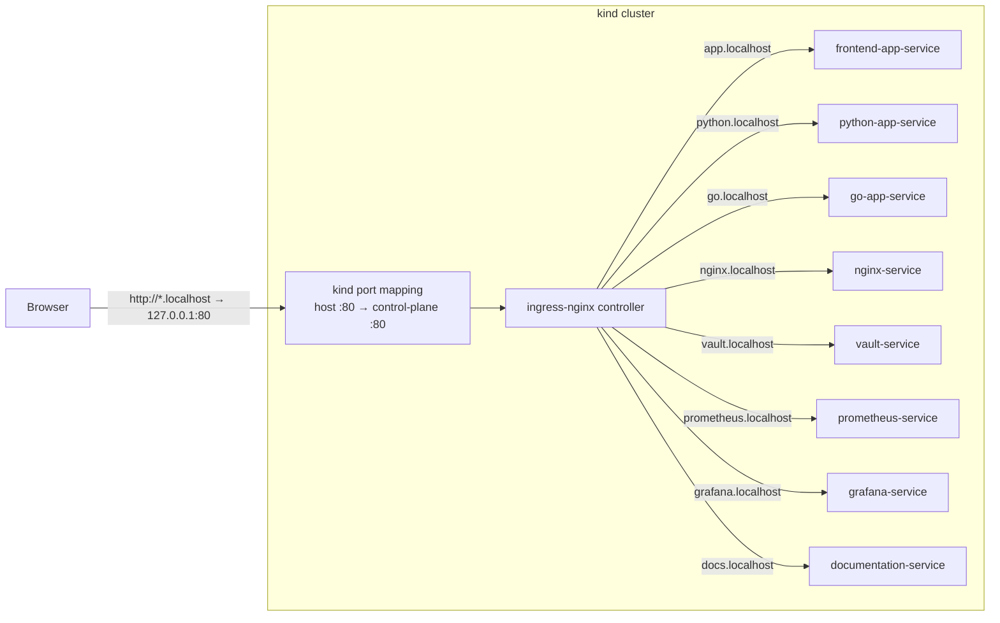
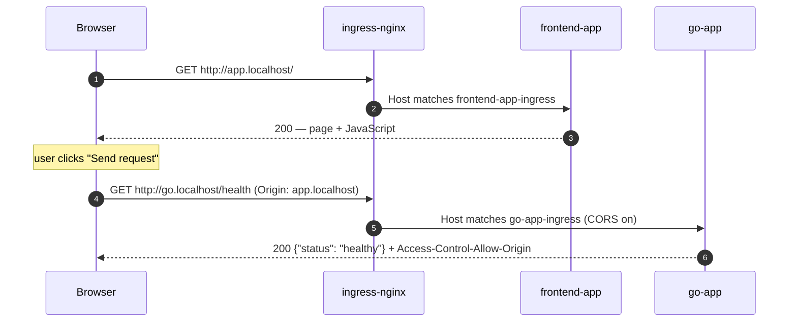

# Design

A local `kind` cluster (1 control-plane node, 2 workers) for practicing platform work:
deploy services, expose metrics, build dashboards, and follow traffic end to end.
The component list is on the [Home](index.md) page.

## How traffic gets in

All traffic from your machine enters through one door: the ingress-nginx controller on port 80.

1. `*.localhost` names resolve to your own machine (127.0.0.1).
2. `kind-cluster.yaml` forwards host port 80 to the control-plane node, where ingress-nginx runs.
3. ingress-nginx reads the `Host` header and picks the matching `Ingress` (one per component, in `<component>/k8s/`).
4. The Ingress sends the request to that component's `ClusterIP` Service, which picks a ready pod.

## Life of a request

The frontend page loads from `app.localhost`, then calls a backend on its own host.
That is a cross-origin call, so the backend Ingresses turn on CORS (`nginx.ingress.kubernetes.io/enable-cors`).

Metrics never leave the cluster: Prometheus scrapes each app inside the cluster and
Grafana reads Prometheus inside the cluster. See [Monitoring](services/monitoring.md).

## Shared backend contract

python-app and go-app answer the same endpoints, so the frontend and tests can use either:

| Endpoint | Answer |
|---|---|
| `GET /` | 200, JSON with a `message` |
| `GET /health` | 200 `{"status": "healthy"}` (also the readiness/liveness probe) |
| `GET /error` | 500 (simulated failure) |
| `GET /redirect` | 302 to `/health` |
| `GET /metrics` | Prometheus metrics |
| `POST /secret` `{"key", "value"}` | 201 stored · 422 invalid input · 502 Vault failed |
| `GET /secret/{key}` | 200 · 404 missing · 502 Vault failed |

Valid key: letters, digits, `_`, `.`, `-`. Value: not empty. Secrets are stored in [Vault](services/vault.md).

## Deployment

`./recreate-cluster.sh` deletes and recreates the cluster, installs ingress-nginx (pinned version),
builds and loads the local images, applies every `<component>/k8s/` directory in order
(monitoring → nginx → Vault → backends → frontend → docs), waits for everything, and
provisions Grafana with Ansible.

## Conventions

- Names: Deployment and `app` label = component name; Service = `<component>-service`; Ingress = `<component>-ingress`.
- Every workload has resource requests/limits and a readiness probe; our own images run as non-root.
- Images are pinned to a version (never `:latest`).
- Dev credentials live in one Secret each (`grafana-admin-secret`, `vault-dev-token`).
