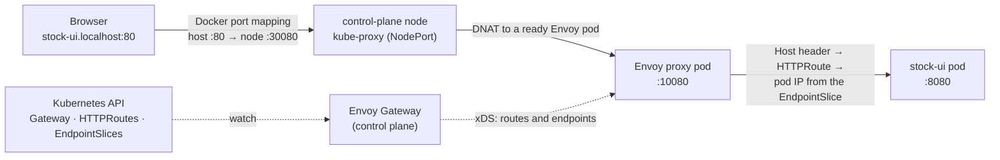

# Networking

How a request gets into the cluster and between pods. The [cluster-map](services/cluster-map.md) page
(http://cluster-map.localhost) shows the same path live, with your cluster's real IPs.

## From your browser to a pod

Every `http://*.localhost` URL enters through one [Gateway API](https://gateway-api.sigs.k8s.io/) Gateway,
`shared-gateway`, run by [Envoy Gateway](https://gateway.envoyproxy.io/).



1. `*.localhost` resolves to `127.0.0.1`. The browser connects to port 80 and sends `Host: stock-ui.localhost`.
2. kind publishes host port 80 to port 30080 of the control-plane node container (`platform/kind-cluster.yaml`).
3. 30080 is the nodePort of Service `envoy-gateway-system/shared-gateway-proxy`. kube-proxy forwards it to an Envoy
   pod, on any node. Envoy listens on 10080 because it runs as non-root and can't bind ports below 1024.
4. Envoy matches the Host header against the HTTPRoutes attached to `shared-gateway`, picks `stock-ui-route`, and
   connects straight to a ready stock-ui pod IP. It skips the Service's ClusterIP: Envoy Gateway already gave it
   the pod addresses from the Service's EndpointSlice.

**Why a NodePort?** On a cloud the Gateway's Service would be `type: LoadBalancer` with an external IP. kind has no
load balancer, so `platform/gateway/envoyproxy.yaml` makes it a NodePort with a fixed port, and kind publishes that
one port. A NodePort is open on every node, so a rescheduled Envoy pod keeps answering. (kind's own
`cloud-provider-kind` gives LoadBalancer IPs, but on macOS it needs `sudo` and publishes them on random host ports.)

## Gateway API objects

| Object | File | Owner | Decides |
|---|---|---|---|
| GatewayClass `envoy-gateway` | `platform/gateway/` | whoever installs the implementation | which controller runs Gateways of this class |
| Gateway `shared-gateway` | `platform/gateway/` | platform team | listeners (HTTP :80, `*.localhost`) and which namespaces may attach routes |
| EnvoyProxy `shared-gateway` | `platform/gateway/` | platform team | how Envoy Gateway runs the proxy: Deployment size, NodePort Service (Envoy Gateway's own CRD) |
| HTTPRoute `<component>-route` | `<component>/k8s/` | each component | hostnames, filters (e.g. CORS) and the backend Service |

- **Control plane:** the `envoy-gateway` pod watches these objects plus Services and EndpointSlices, turns them into
  Envoy configuration, and streams it to the proxies over xDS (gRPC). It creates the proxy Deployment and Service
  for each Gateway and writes status back. No request passes through it.
- **Data plane:** the `shared-gateway-proxy` pods (Envoy). Every request passes through them. A new or changed
  HTTPRoute takes effect a moment after `kubectl apply`, with no restart.
- **Status:** the controller writes conditions onto each object. A Gateway is `Programmed` once its proxy runs.
  A route is `Accepted` once a listener admits it, and `ResolvedRefs` once its backend Service exists.
- **Who may attach:** the listener admits routes only from namespaces labelled `shared-gateway-access: "true"`
  (`platform/namespaces.yaml`). `data` has no label, so TimescaleDB can't be exposed by accident. A route there
  gets `Accepted: False` with reason `NotAllowedByListeners`.

## Exposing a service

Add `<component>/k8s/<component>-route.yaml` in a labelled namespace. With no `matches`, a rule matches every path:

```yaml
apiVersion: gateway.networking.k8s.io/v1
kind: HTTPRoute
metadata:
  name: my-service-route
  namespace: apps
  labels:
    app: my-service
spec:
  parentRefs:
    - name: shared-gateway
      namespace: envoy-gateway-system
  hostnames:
    - my-service.localhost
  rules:
    - backendRefs:
        - name: my-service-service
          port: 80
```

## CORS

stock-ui and traffic-generator run in your browser and call `http://stock.localhost` from another origin.
`stock-app-route` has a standard `CORS` filter (Gateway API v1.5+) that allows exactly those two origins and `GET`.
Envoy answers the preflight `OPTIONS` itself and adds `Access-Control-Allow-Origin` for allowed origins, so stock-app
has no CORS code.

## Inside the cluster

Pod-to-pod traffic never touches the Gateway. stock-app connects to `timescaledb-service.data`, CoreDNS returns the
Service's ClusterIP, kube-proxy's NAT rules on the sending node rewrite it to a ready pod IP, and kindnet routes the
packet to the node that owns that pod IP range, without a tunnel or NAT.

## Why Gateway API

This cluster used ingress-nginx, which was retired upstream in March 2026 and gets no more fixes. The Ingress API is
frozen: anything beyond host and path, like CORS, needed controller-specific annotations
(`nginx.ingress.kubernetes.io/enable-cors`). Gateway API makes those typed, validated fields and splits the
platform's part (Gateway) from each app's part (HTTPRoute). Any conformant implementation (Envoy Gateway, Istio,
Cilium, NGINX Gateway Fabric) can run the same routes.

## Try it

```sh
kubectl get gatewayclass,gateway,httproute -A                  # objects and their status
kubectl describe httproute stock-app-route -n apps             # conditions with messages
kubectl get svc,pods -n envoy-gateway-system -o wide           # controller, Envoy pods, NodePort Service
docker exec sample-cluster-control-plane iptables -t nat -S KUBE-NODEPORTS   # the 30080 rule
kubectl port-forward -n envoy-gateway-system deploy/shared-gateway-proxy 19000:19000 &
curl -s localhost:19000/clusters | grep stock-app-route | grep hostname      # pod IPs Envoy sends to
```
