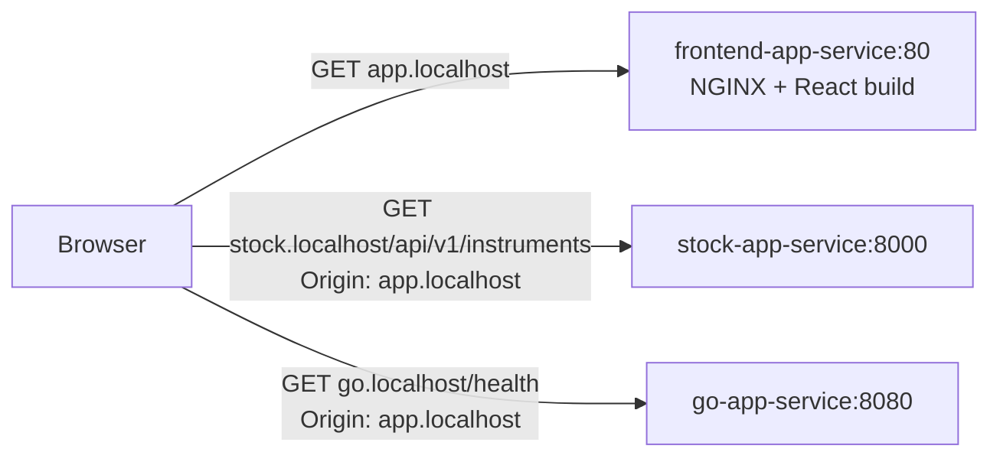

# frontend-app

**API Tester** — a React UI for driving traffic at the backends by hand: pick
an app, pick an endpoint, fire a burst of requests, watch the results — and
then watch the same traffic appear in [Grafana](grafana.md).

| | |
|---|---|
| Directory | `frontend-app/` |
| Image | `frontend-app:dev` (React build served by NGINX) |
| Namespace | `apps` |
| Host | http://app.localhost |

This is the *traffic* tool. The market data interface is a separate app —
[stock-ui](stock-ui.md) at http://stock-ui.localhost.

## What it does

- Targets either [stock-app](stock-app.md) or [go-app](go-app.md), chosen with the tabs in the bar
- Calls any endpoint the chosen backend offers, including stock-app's
  `/api/v1/instruments/{symbol}/bars` with a ticker and a session-date window
- Sends 1–100 concurrent requests, so a burst is visible on a dashboard
- Reports answered/failed counts, average response time, and each individual response

stock-app is the backend worth driving because it is the one that does real
work: repeating a date window exercises the cache-aside path, and a window it
has never synced exercises the provider path. Both show up differently on a
dashboard.

## Redirects are followed before the app sees them

go-app's `/redirect` answers **302 → `/health`**, but the tester reports
`200 OK`. That is the browser, not a bug: `XMLHttpRequest` — which axios uses in
a browser — follows redirects internally and hands back only the final
response. The 3xx never reaches JavaScript, and there is no way to ask for it:
axios's `maxRedirects` is a Node-only option, and `fetch`'s `redirect: 'manual'`
returns an opaque cross-origin response with status `0` and no `Location`.

What survives is `XMLHttpRequest.responseURL`, the URL the answer came from.
When it differs from the URL requested, a redirect was followed, and the row
says so — `200 OK · followed to /health`, coloured as a redirect rather than a
plain success.

To see the 302 itself, use a client that lets you turn following off:

```sh
curl -si http://go.localhost/redirect | head -1   # HTTP/1.1 302 Found
```

which is what `e2e/tests/test_backend_workflows.py` does, with
`allow_redirects=False`.

## Look and feel

The app shares [stock-ui](stock-ui.md)'s design system: the same tokens, the
same primitives (`card`, `pill`, `label`, `stat`), dark by default with the
same light-mode switch kept in local storage. The two are separate builds with
no package shared between them, so `src/styles/theme.css` is **deliberately
duplicated** in both apps and the two files must be changed together.

The only addition here is a block of status tones — 2xx, 3xx, 4xx and outright
failures — which colour the rail on the left edge of each response row. A price
chart never has to show an HTTP status, so stock-ui carries no such tokens.

## How it reaches the backends

The SPA calls the backends **directly on their own ingress hosts**
(`http://stock.localhost/…`, `http://go.localhost/…`), not through a proxy on
its own origin. Those are cross-origin requests, so both backend Ingress
resources set `nginx.ingress.kubernetes.io/enable-cors: "true"`.

This replaced an earlier `/api/python/` → `/api/go/` NGINX proxy inside the
frontend pod. Calling the real hosts means the browser exercises the same
ingress path the e2e suite and a human with `curl` do, and CORS behaviour is
tested rather than bypassed.



## Redeploy into a running cluster

From the repository root:

```sh
docker build -t frontend-app:dev ./frontend-app
kind load docker-image frontend-app:dev --name sample-cluster
kubectl rollout restart deployment frontend-deployment -n apps
```

## Run it on its own

Needs Node.js 18+.

```sh
cd frontend-app
npm install
npm start        # http://localhost:3000
npm run build    # production bundle, what the image serves
```

Against a running cluster the dev server still calls `*.localhost`, so the
backends must be up for anything but the shell to work.

## Layout of the source

```text
src/
  api/backends.js      the only module that makes a request
  lib/endpoints.js     the backends and the endpoints each one offers
  lib/run.js           burst bounds, status tones, run statistics
  hooks/useTheme.js    the dark/light choice, kept in local storage
  components/          navigation, request form, endpoint list, statistics, results
  styles/              tokens, layout, components — see stock-ui
```

`lib/` holds pure functions only: which URL a set of choices produces, which
tone a status code is read in, what a run's four figures come to. Nothing there
touches the network or React.
