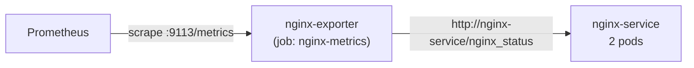

# NGINX

A stock NGINX serving a static page. It exists to be a *third* kind of
monitored workload: unlike the sample backends it does not speak Prometheus
itself, so it is scraped through a sidecar exporter — the pattern you need for
any off-the-shelf component.

| | |
|---|---|
| Directory | `nginx/` |
| Image | `nginx:1.25` (public, pulled by the node — no `kind load`) |
| Namespace | `apps` |
| Host | http://nginx.localhost |
| Replicas | 2, so the Service load-balances across pods |
| Prometheus job | `nginx-metrics` |

## Manifests

| File | Purpose |
|---|---|
| `nginx-deployment.yaml` | Deployment (2 replicas) + `nginx-service` |
| `nginx-config.yaml` | ConfigMap holding `nginx.conf`, including the `/nginx_status` location |
| `configmap.yaml` | `nginx-env-config`, environment values for the container |
| `nginx-exporter.yaml` | Exporter Deployment + annotated `nginx-exporter` Service |
| `nginx-ingress.yaml` | Ingress for `nginx.localhost` |
| `nginx-serviceaccount.yaml` | Zero-privilege ServiceAccount |

## How the metrics get out

NGINX publishes a terse plaintext summary at `/nginx_status` (the `stub_status`
module) which Prometheus cannot read. `nginx/nginx-prometheus-exporter` sits
next to it and translates:



1. The exporter polls `http://nginx-service/nginx_status`.
2. It converts the counters into Prometheus exposition format.
3. It serves them on port 9113.
4. Prometheus discovers the **exporter's** Service — not NGINX's — because
   that is the one carrying `prometheus.io/scrape: "true"` and
   `prometheus.io/job: nginx-metrics`.

What you get: request rate, active/handled/accepted connections, and the
reading/writing/waiting connection breakdown. There is no per-URL or per-status
detail — `stub_status` simply does not report it.

## Redeploy into a running cluster

```sh
kubectl apply -f nginx/k8s/
kubectl rollout restart deployment nginx-deployment -n apps
```

Editing `nginx-config.yaml` needs the restart: a ConfigMap change does not
reload a running NGINX by itself.
