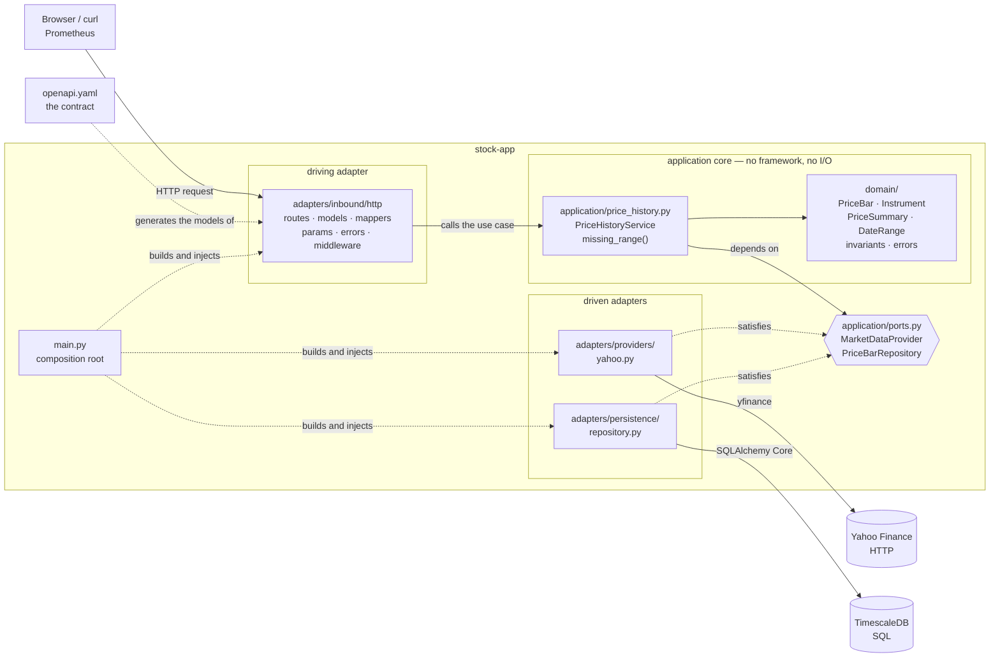

# stock-app

A FastAPI service that serves standardized daily OHLCV bars. It reads from
[TimescaleDB](timescaledb.md) and calls an external market data provider only
for data it does not already hold, so repeated requests for the same window
cost one database query and no network call.

It is the first component in this cluster that is a *real* data service rather
than a traffic sample: it does **not** implement go-app's sample contract — no
`/error`, no `/redirect`. It does share go-app's `/secret` endpoints, backed by
its own Vault path `services/stock-app/` (see [Vault](vault.md)).

| | |
|---|---|
| Directory | `stock-app/` |
| Contract | `stock-app/openapi.yaml` (OpenAPI 3.1), served unchanged at `/openapi.yaml`, [rendered here](stock-app-api.md) |
| Image | `stock-app:dev` (~590 MB; yfinance pulls pandas, numpy and curl_cffi) |
| Namespace | `apps` |
| Host | http://stock.localhost |
| Swagger UI | http://stock.localhost/docs |
| Prometheus job | `stock-app` |
| Database | `timescaledb-service.data:5432` |

```sh
curl "http://stock.localhost/api/v1/instruments/AAPL/bars?start=2026-06-01&end=2026-06-30"
curl "http://stock.localhost/api/v1/instruments/AAPL/summary?start=2026-06-01&end=2026-06-30"
curl "http://stock.localhost/api/v1/instruments"
```

## Architecture

Hexagonal (ports and adapters). The core in the middle holds the rules and the
decisions; everything that talks to the outside world is an adapter plugged
into a port. Dependencies point **inwards only**: an arrow never leaves the
core.



| Ring | Lives in | What is in it | What it is responsible for | May import |
|---|---|---|---|---|
| **Domain** | `src/domain/` | `PriceBar`, `Instrument`, `PriceSummary`, `DateRange`, `Interval`, `DataSource`, and the error types | The vocabulary and the invariants. A bar that violates OHLC consistency, carries a non-positive price or sits in the future cannot be constructed, whatever produced it | stdlib, pydantic |
| **Core (application)** | `src/application/price_history.py` | `PriceHistoryService`, `missing_range()` | The one decision this service exists to make: *do I already hold this window, or must I go and fetch it?* Orchestrates the ports; performs no I/O itself and knows no status codes | `domain`, own ports, `observability` |
| **Ports** | `src/application/ports.py` | `MarketDataProvider`, `PriceBarRepository` — `typing.Protocol`, not ABCs | The core's terms for what it needs from the outside: "give me bars for this range", "store these". Structural typing means an adapter satisfies a port without importing it, and a test fake needs no inheritance | `domain` |
| **Driving adapter** | `src/adapters/inbound/http/` | `routes.py`, `models.py` (generated), `mappers.py`, `params.py`, `spec.py`, `deps.py`, `errors.py`, `middleware.py` | Turns HTTP into use-case calls and back: parameter validation (422 before the core runs), camelCase JSON with prices as numbers, domain errors → 404/502/503, request metrics | FastAPI, core, `domain` |
| **Driven adapter — provider** | `src/adapters/providers/yahoo.py` | `YahooMarketDataProvider` | Satisfies `MarketDataProvider`. Owns every pandas detail: exchange-local session dates, dropped holiday rows, dedupe, rounding, and counting rows that fail validation instead of raising | yfinance, pandas, `domain` |
| **Driven adapter — persistence** | `src/adapters/persistence/` | `tables.py`, `engine.py`, `repository.py` | Satisfies `PriceBarRepository`. Owns the hypertable, the `ON CONFLICT` upsert, the Timescale `first()`/`last()` summary, and translating driver failures into `RepositoryError` | SQLAlchemy, `domain` |
| **Composition root** | `src/main.py` | `create_app()`, `build_provider()` | The only place a concrete adapter is named. Swapping Yahoo for Alpha Vantage, or Timescale for anything else, is an edit to this file | everything |
| **Cross-cutting** | `src/observability/`, `src/config.py` | Metric definitions, stdout logging, `pydantic-settings` | Sit *below* the core so both it and the adapters may report into them. `metrics.py` deliberately imports no web framework, or the core would inherit FastAPI | prometheus_client, stdlib |

`migrations/` sits outside the rings: Alembic revisions, applied by an
initContainer on every rollout.

The practical payoff: `test_domain_models.py` and `test_price_history.py` prove
the whole use case with pandas, SQLAlchemy and FastAPI unimportable and no
database running.

### The rule is enforced, not reviewed

`stock-app/.importlinter` declares four contracts that
[import-linter](https://import-linter.readthedocs.io/) checks on every
`make lint-python`, via an extra `lint-imports` command in that service's
`tox -e pre-commit` environment:

| Contract | What it forbids |
|---|---|
| Dependency rule | Any import pointing outwards: `main → adapters → application → observability → domain` |
| Pure core | `domain` or `application` importing FastAPI, SQLAlchemy, psycopg, Alembic, yfinance, pandas, numpy — or `os` |
| Provider owns pandas | pandas, numpy or yfinance appearing outside `adapters/providers` |
| Persistence owns SQLAlchemy | SQLAlchemy or psycopg appearing outside `adapters/persistence` |

A violation fails the build with the offending import and its line number, so
the architecture cannot rot quietly between reviews. This and the API contract
check below are why stock-app's `tox.ini` departs from the copy-it-verbatim
convention in [Adding a Service](../adding-a-service.md).

### Adding a provider

1. Write `src/adapters/providers/<name>.py` with a class exposing `name`,
   `fetch_daily_bars(symbol, start, end)` and `fetch_instrument(symbol)`.
   Structural typing means it does not import or subclass anything.
2. Return `PriceBar` objects. Whatever shape the upstream data has, the domain
   invariants below are what reaches the database.
3. Register it in `build_provider()` in `src/main.py`.
4. Select it with `STOCK_PROVIDER=<name>` in the Deployment.

An API key belongs in [Vault](vault.md) under `services/stock-app/<key>` —
never in a manifest or an image.

### The recorded provider

`fixture` is the second provider, and it exists because Yahoo rate-limits
datacenter IPs: without it CI could only ever prove that stock-app *rejects*
bad requests, never that it returns bars. It replays
`stock-app/fixtures/market-data.json`, a real Yahoo response captured by
`tools/record_market_data.py`:

```sh
cd stock-app && tox -e record   # calls Yahoo, rewrites the recording
STOCK_PROVIDER=fixture ./recreate-cluster.sh
```

The recording holds real prices on the session dates they actually occurred on.
It is clipped to the requested range and never extrapolated, so a range outside
the recorded window answers with no bars — the same answer a live provider
gives for a market that was shut. An unrecorded symbol raises
`SymbolNotFoundError`, so the 404 path behaves identically in both modes.

Two consequences worth knowing:

- `source` on stored rows and in `/api/v1/instruments` reads `fixture`, not
  `yahoo`. The prices are Yahoo's, but the service really is replaying them
  from a file and should not claim to have just called an API.
- The recording ages. The e2e window is a year wide precisely so it keeps
  overlapping the recorded window for about a year; re-run `tox -e record`
  when it stops, which `test_fixture_provider.py` and the e2e suite will both
  make obvious.

## Standardization

Every bar is validated on the way in, so the store holds the same shape
regardless of which provider produced it.

| Rule | Enforced as |
|---|---|
| `symbol` stripped, uppercased, matching `^[A-Z0-9.\-]{1,16}$` | field validator |
| Prices quantized to 4 decimal places, matching `numeric(18,4)` | field validator |
| `open`, `high`, `low`, `close` > 0 and `volume` >= 0 | field constraint |
| `low <= min(open, close)`, `high >= max(open, close)`, `high >= low` | model validator |
| `session_date` not in the future | model validator |

The last rule allows one day of slack: exchanges east of UTC open on a session
date that is still tomorrow in UTC.

**Raw OHLC and `adj_close` are both stored.** Adjusted prices are rewritten
retroactively by every split and dividend, which makes the raw columns the only
ones that can be reconciled against a provider later.

Cleaning happens in the provider adapter, vectorized over the DataFrame, and
domain objects are materialized once at the end:

| Step | Operation |
|---|---|
| Drop holiday and trading-halt rows | `dropna(subset=["Open","High","Low","Close"])` |
| Exchange-local index → session date | `index.date` (yfinance localizes to the exchange timezone) |
| Deduplicate, keeping the last | `~index.duplicated(keep="last")` |
| Sort chronologically | `sort_index()` |
| Round prices | `round(4)` |

A row that still violates an invariant is counted as
`stock_provider_rows_rejected_total` and dropped — never a 500.

## The cache-aside algorithm

```text
get_price_history(symbol, start, end):
    coverage    = repo.get_instrument(symbol)          # the sync ledger
    fetch_range = missing_range(coverage, requested)   # None => fully cached

    if fetch_range is not None:
        instrument = provider.fetch_instrument(symbol)     # raises SymbolNotFoundError
        bars       = provider.fetch_daily_bars(symbol, fetch_range)
        repo.save_bars(instrument.with_coverage(fetch_range, now), bars)   # one transaction

    return repo.bars_in_range(symbol, start, end)
```

### The coverage ledger

**Cache completeness cannot be decided by counting rows.** Markets close on
weekends and holidays, so a 30-day window holds about 21 bars and the exact
number varies by exchange. A missing row is indistinguishable from a day the
market was shut.

So the `instruments` table records *how far the provider has been queried*:
`first_synced_date` and `last_synced_date` hold the session-date window that
has been **requested**, not the dates of the bars that came back. Requesting a
window that starts on a Saturday still marks that Saturday as synced, so the
identical request a second later is a cache hit.

| Coverage state | Fetched range |
|---|---|
| No instrument row | `[start, end]` |
| `start` before `first_synced_date` | `[start, end]` — backward extension |
| `end` beyond `last_synced_date` | `[last_synced_date, end]` — tail extension |
| `end` at `last_synced_date`, last sync older than `STOCK_STALE_AFTER_SECONDS` | `[last_synced_date, end]` — tail refresh |
| Anything else | nothing — cache hit |

Two properties fall out of this table:

- **At most one provider call per request.** When both ends are missing the
  range is widened into one contiguous window rather than fetched as a gap list.
- **Only the trailing edge ever refetches.** Today's bar moves intraday and
  closes get revised by later adjustments, so the most recent synced day is
  treated as unsettled and refetched once it goes stale (default: one hour).
  Older bars are immutable and always come from the store.

## HTTP API

The contract comes first. `openapi.yaml` is hand-authored and the Python is
generated from it, so no module restates the wire format.

| | |
|---|---|
| Source of truth | `stock-app/openapi.yaml` — OpenAPI 3.1 |
| Generated from it | `src/adapters/inbound/http/models.py` — every response model, by [datamodel-code-generator](https://koxudaxi.github.io/datamodel-code-generator/) |
| Published as | `/openapi.yaml` (`application/yaml`) — the file itself, not a document derived from the code; Swagger UI renders it at `/docs`. FastAPI's derived `/openapi.json` is turned off |
| Regenerate | `cd stock-app && tox -e api` |

The loop is: edit the contract, run `tox -e api`, and the models change until
`mappers.py` no longer satisfies them — which `tox -e tests` reports. Field
names, types, nullability, enums and the reasoning behind each of them live in
the contract alone, which is why the shape of a response is documented at
http://stock.localhost/docs rather than repeated here. Everything the service
returns uses camelCase keys, prices as JSON numbers and bare session dates.

| Method | Path | Operation | Purpose |
|---|---|---|---|
| `GET` | `/api/v1/instruments` | `listInstruments` | Symbols held locally, with their synced window |
| `GET` | `/api/v1/instruments/{symbol}/bars` | `getPriceHistory` | Cache-aside bars |
| `GET` | `/api/v1/instruments/{symbol}/summary` | `getPriceSummary` | Period analytics |
| `GET` | `/health` | `getHealth` | Readiness probe; reports database reachability |
| `GET` | `/metrics` | `getMetrics` | Prometheus exposition |
| `GET` | `/` | `getServiceIdentity` | Service identity, used by the cluster smoke tests |
| `POST` | `/secret` | `storeSecret` | Store a secret under `services/stock-app/` in Vault |
| `GET` | `/secret/{key}` | `readSecret` | Read a secret from that path |

Every handler in `routes.py` names the `operationId` it implements, which is
what ties a route to its declaration.

### Rules the contract can describe but not declare

`start` and `end` are both **required** inclusive session dates — no `days`
shorthand and no implicit "end defaults to today", which would make an
identical request change its answer under the caller. Three further rules
answer 422 before the use case runs:

- `start <= end`
- `end` not in the future
- the span is at most 3650 days

Each relates two parameters to each other, and JSON Schema has no vocabulary
for that, so all three are enforced in `params.py` and only described in the
contract.

### Errors

Every 4xx and 5xx answers the contract's single `ErrorResponse`,
`{"detail": "…"}` — request validation included, whose FastAPI default is a
list of pydantic error objects instead. One endpoint answering failures in two
different shapes depending on which check caught them is precisely what
publishing a contract is meant to rule out.

| Condition | Status |
|---|---|
| Provider does not know the symbol | 404 |
| Symbol or requested window violates a rule | 422 |
| Provider unreachable or returning garbage | 502 |
| TimescaleDB unreachable | 503 |

Domain errors meet HTTP in exactly one module,
`adapters/inbound/http/errors.py`.

### Keeping code and contract in step

A published contract nobody checks is a wish, so four checks fail the build:

| Check | Catches | Run by |
|---|---|---|
| Regenerating the models produces no diff | A contract edit that was never regenerated | `make lint-python` |
| The contract validates against the OpenAPI 3.1 schema | A broken `$ref` outside `components/schemas`, which generation never reads | `make test-unit-python` |
| The operations FastAPI derives from the routes equal the declared ones | A route no operation declares, or an operation no route implements | `make test-unit-python` |
| `SYMBOL_PATTERN` and the 3650-day cap match what is published | A limit changed in code, leaving the description behind | `make test-unit-python` |

The first regenerates into a temporary file and diffs it; the other two live in
`tests/test_openapi_contract.py`, which also asserts that `/openapi.yaml`
serves the contract file byte for byte and that no `/openapi.json` exists.

## Schema

stock-app owns the schema even though the database is a separate component —
the Alembic revisions live in `stock-app/migrations/` and nothing in
`timescaledb/` creates a table.

```sql
CREATE TABLE instruments (
    symbol             text PRIMARY KEY,
    name               text,
    exchange           text,
    currency           text,
    first_synced_date  date,          -- the sync ledger, see above
    last_synced_date   date,
    last_synced_at     timestamptz,
    source             text NOT NULL
);

CREATE TABLE price_bars (
    symbol       text          NOT NULL REFERENCES instruments(symbol) ON DELETE CASCADE,
    interval     text          NOT NULL,
    ts           timestamptz   NOT NULL,   -- session date at 00:00:00 UTC
    open         numeric(18,4) NOT NULL,
    high         numeric(18,4) NOT NULL,
    low          numeric(18,4) NOT NULL,
    close        numeric(18,4) NOT NULL,
    adj_close    numeric(18,4),
    volume       bigint        NOT NULL,
    source       text          NOT NULL,
    ingested_at  timestamptz   NOT NULL DEFAULT now(),
    PRIMARY KEY (symbol, interval, ts)
);

SELECT create_hypertable('price_bars', by_range('ts', INTERVAL '1 year'));
```

- `ts` holds the session date at UTC midnight; the exchange-local conversion
  happens in the provider adapter.
- `ts` is part of the primary key because **TimescaleDB requires the
  partitioning column in every unique index**. It is also the `ON CONFLICT`
  target of the upsert, which makes re-ingesting a window idempotent and lets
  revised closes overwrite stale ones.
- The chunk interval is one year: the 7-day default would create a near-empty
  chunk every week for daily bars.

The summary endpoint uses two Timescale-specific aggregates, `first()` and
`last()`, which take the value of one column ordered by another in a single
pass.

**Migrations** run as an initContainer on the stock-app Deployment
(`alembic upgrade head`). They are idempotent through the `alembic_version`
table, so a second `recreate-cluster.sh` run is a no-op.

The access layer is SQLAlchemy **Core**, not the ORM: the repository port
returns frozen domain objects, so an identity map and lazy loading would buy
nothing. One engine with `pool_pre_ping=True` (the database is a separate pod
that can restart underneath the pool) and every method wrapped in one
transaction.

## Metrics

Five service-specific series on top of the shared HTTP middleware, described
with the rest of the pipeline in [Monitoring](monitoring.md). **No metric is
labeled by `symbol`** — symbols come from untrusted request paths, so that
would be an unbounded-cardinality denial of service vector.

## Configuration

Every setting is read from an environment variable — `STOCK_`-prefixed, except the
`VAULT_*` ones shared with go-app; the Deployment sets them all.

| Variable | Default | Purpose |
|---|---|---|
| `STOCK_DB_HOST` | `timescaledb-service.data` | Database host, namespace-qualified in-cluster |
| `STOCK_DB_PORT` | `5432` | Database port |
| `STOCK_DB_NAME` | `stockdata` | Database name |
| `STOCK_DB_USER` | `stockapp` | Database role |
| `STOCK_DB_PASSWORD` | `stockapp` | From the `stock-app-secret` Secret in the cluster |
| `STOCK_PROVIDER` | `yahoo` | Market data provider to construct: `yahoo` calls the real API, `fixture` replays the recording in the image |
| `STOCK_STALE_AFTER_SECONDS` | `3600` | How long a synced trailing edge stays fresh |
| `VAULT_ADDR` | `http://vault-service.vault:8200` | Vault URL, namespace-qualified in-cluster |
| `VAULT_TOKEN` | `root` | From the `vault-dev-token` Secret in the cluster |
| `VAULT_SECRET_PATH` | `stock-app` | This service's path under the `services/` mount |

**Logs go to stdout only.** The container runtime owns log collection, and a
writable log directory would defeat the `readOnlyRootFilesystem: true` the
Deployment asks for.

## Security notes

| Concern | Mitigation |
|---|---|
| SQL injection | SQLAlchemy Core bound parameters only, never f-string SQL; `symbol` is regex-validated in the domain first |
| Provider-abuse amplification | The endpoint is unauthenticated, so the span is capped at 3650 days, future `end` is rejected, the symbol alphabet prevents URL injection, one provider call per request is the maximum, and the ledger absorbs repeats. Add `nginx.ingress.kubernetes.io/limit-rps` if that stops being enough |
| Metric cardinality | No metric is labeled by `symbol`; unmatched routes collapse to a constant label |
| Credentials | Kubernetes Secret, same posture as `grafana-admin-secret`: base64, **not** encrypted, dev playground only |
| Container hardening | Non-root user, `allowPrivilegeEscalation: false`, `readOnlyRootFilesystem: true`, all capabilities dropped; `/tmp` and the home directory are `emptyDir` volumes because yfinance caches exchange timezones under `~/.cache` |
| Supply chain | yfinance is an unofficial scraper that ships `curl_cffi` for TLS impersonation. It is pinned exactly, bandit runs over the service, and the provider port makes replacing it a one-file change |

## Redeploy into a running cluster

From the repository root:

```sh
docker build -t stock-app:dev ./stock-app
kind load docker-image stock-app:dev --name sample-cluster
kubectl rollout restart deployment stock-app -n apps
```

The rollout re-runs the migration initContainer, which is a no-op when the
schema is already current.

## Run it on its own

The service needs a reachable TimescaleDB. The quickest one:

```sh
docker run -d --name stockdb -p 5432:5432 \
  -e POSTGRES_DB=stockdata -e POSTGRES_USER=stockapp -e POSTGRES_PASSWORD=stockapp \
  timescale/timescaledb:2.28.3-pg17

cd stock-app
pip install -r requirements.txt
export STOCK_DB_HOST=localhost
alembic upgrade head
uvicorn src.main:app --host 0.0.0.0 --port 8000
```

## Testing

Unit tests run under `unittest` via tox and need neither a database nor a
network:

| File | Covers |
|---|---|
| `test_domain_models.py` | Every standardization rule and the ledger arithmetic |
| `test_price_history.py` | The use case against in-memory fakes, plus `missing_range` in isolation |
| `test_yahoo_provider.py` | DataFrame fixture → bars: timezones, dropped rows, dedupe, ordering, counted rejections |
| `test_routes.py` | `TestClient` with `dependency_overrides`: response shape, camelCase, 404/422/502/503 |
| `test_openapi_contract.py` | Routes against the contract: operation parity, the published document, the two rules stated in prose |
| `test_fixture_provider.py` | The recorded provider: clipping, unrecorded symbols, unusable recordings, and that the committed recording still loads |
| `test_vault_secret_store.py` | The Vault adapter: per-service path, 404 for a missing key, 502 when Vault fails |
| `test_config.py` | Settings parsing and database URL assembly |

`TimescalePriceBarRepository` needs a real Postgres and is covered by the
end-to-end suite instead — upsert idempotency, hypertable writes and the
summary query.

End-to-end coverage is split in two: `e2e/tests/test_stock_api.py` walks every
endpoint and validates each response against the contract the running pod
publishes, and `e2e/tests/test_stock_workflows.py` covers the cache-aside
pipeline. The tests that reach Yahoo Finance carry the `external` marker;
**Yahoo rate-limits datacenter IPs**, so CI runs `-m "not external"` and those
cases run locally. See [End-to-End Tests](../e2e-tests.md).

```sh
cd stock-app && tox -e tests       # this service only
cd stock-app && tox -e pre-commit  # black, bandit, import contracts, API drift
cd stock-app && tox -e api         # regenerate the models after a contract edit
make test-unit-python              # every Python service
./recreate-cluster.sh && make test-e2e
```
