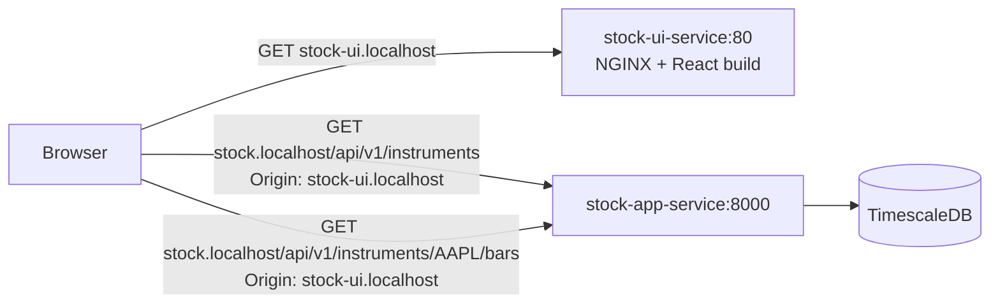

# stock-ui

**Stock App** — the React interface for the market data in this cluster: search
a company, chart its daily bars as a line or as candles, and read a price off
any session on the chart.

| | |
|---|---|
| Directory | `stock-ui/` |
| Image | `stock-ui:dev` (React build served by NGINX) |
| Namespace | `apps` |
| Host | http://stock-ui.localhost |

It is a second, separate frontend: [frontend-app](frontend-app.md) stays at
http://app.localhost as the request-burst tool that drives traffic for
[Grafana](grafana.md). Neither replaces the other.

## What is real and what is not

Exactly one thing in this app talks to a backend: the market data.

| Area | Backed by |
|---|---|
| Company search | [stock-app](stock-app.md) `GET /api/v1/instruments` |
| Price chart, range change, period statistics | stock-app `GET /api/v1/instruments/{symbol}/bars` |
| Indicator panels under the chart | Nothing — reserved slots, see below |
| Portfolio, Watchlist, account menu | Nothing — fixed data in `src/mocks/demoData.js` |

There is no account, session, or auth of any kind. The mocked areas say so on
screen rather than implying a backend that does not exist.

## Searching for a company

stock-app has no company-search endpoint, so search works against what it
already holds:

1. `GET /api/v1/instruments` lists every instrument in TimescaleDB, with its
   company name. The dropdown filters that list on ticker *and* name, so
   "microsoft" finds `MSFT` once `MSFT` has been charted at least once.
2. A ticker that is not in the list is still offered as its own suggestion.
   Choosing it requests bars for it, which makes stock-app fetch the symbol
   from the market data provider — and the instrument list is reloaded
   afterwards, so it becomes searchable by name from then on.

A first-time symbol is therefore noticeably slower than one already synced, and
the header says which of the two answered (`From store` / `From provider`).

## Filters and the change percentage

- **Chart type** — Line (a filled area over the closing price) or Candles
  (open/high/low/close per session).
- **Time range** — 1W, 3M, 6M, 1Y, 5Y, and **1M by default**.

Both windows are derived in **UTC**: stock-app rejects an end date in the
future and compares against UTC today, so a browser east of UTC would otherwise
ask for tomorrow just after midnight and get a 422.

The percentage next to the price is measured close-to-close over the bars the
selected range actually returned — not over the dates requested. A range
starting on a weekend begins at the first session inside it, so the number
always describes the line that is drawn.

## Reading a price off the chart

Hovering any point on the line, or any candle, pins a readout card to the
crosshair showing that session's date, close, open, high, low and volume. It
works the same in both chart types: the bars are indexed by session date, so
the full bar is available even when only the close is drawn.

The `−` / `+` / fit controls on the right of the toolbar zoom the visible
window; the chart also pans and zooms by drag and wheel.

## Indicator panels

The two panels under the chart — *Price and chart analysis* and *Fundamental
analysis* — are **placeholders**. Which indicators are worth showing has not
been decided, and neither this app nor stock-app calculates any of them yet.
They render as empty slots marked "Not calculated yet" rather than as
plausible-looking numbers, and the slot names live in one array
(`INDICATOR_PANELS` in `src/components/IndicatorPanels.js`) so replacing them
later is a single edit.

## Themes and screen sizes

Dark is the default and is what the interface is designed for; the switch in
the navigation bar toggles light mode and the choice is kept in local storage.
The layout collapses in two steps — below 960px the section tabs move behind a
toggle, below 620px the search box takes its own full-width row. The search box
never collapses into an icon, because finding a company is the whole point of
the bar.

Colours live in `src/styles/theme.css` as custom properties for both schemes.
The chart draws to a canvas and cannot inherit them, so `src/lib/palette.js`
restates the handful it needs; the two must be changed together.

## How it reaches stock-app

The SPA calls stock-app **directly on its own ingress host**
(`http://stock.localhost/api/v1/…`), not through a proxy on its own origin —
the same arrangement [frontend-app](frontend-app.md) uses. Those are
cross-origin requests, so `stock-app/k8s/stock-app-ingress.yaml` sets
`nginx.ingress.kubernetes.io/enable-cors: "true"`, and
`e2e/tests/test_stock_ui.py` checks that the header actually comes back for
this origin.



## Redeploy into a running cluster

From the repository root:

```sh
docker build -t stock-ui:dev ./stock-ui
kind load docker-image stock-ui:dev --name sample-cluster
kubectl rollout restart deployment stock-ui-deployment -n apps
```

## Run it on its own

Needs Node.js 18+.

```sh
cd stock-ui
npm install
npm start        # http://localhost:3000
npm test         # Jest + React Testing Library
npm run build    # production bundle, what the image serves
```

!!! warning "The `typescript` override in `package.json` is load-bearing"

    `"overrides": { "typescript": "5.1.6" }` is not leftover boilerplate — the
    same pin is in `frontend-app/package.json` for the same reason. Without
    it, npm resolves a TypeScript that breaks the
    `@typescript-eslint/experimental-utils` chain `eslint-plugin-jest` depends
    on. The plugin then fails to load and `npm run build` dies with the
    misleading `Environment key "jest/globals" is unknown`. There is no
    TypeScript in this app; the pin exists only to keep CRA's lint chain
    resolvable.

The dev server still calls `http://stock.localhost`, so stock-app must be up
for anything but the shell to work. Point it elsewhere with
`REACT_APP_STOCK_API_URL`:

```sh
REACT_APP_STOCK_API_URL=http://localhost:8000 npm start
```

## Layout of the source

```text
src/
  api/stockApi.js      the only module that makes a request
  lib/                 pure functions: ranges, series maths, formatting, matching
  hooks/               theme, instrument list, price-history loading
  components/          navigation, search, chart, toolbar, statistics, panels
  views/               Markets (real), Portfolio and Watchlist (demo)
  mocks/demoData.js    every value that is not from a backend
  styles/              tokens, layout, components
```

The maths that produces a number on screen — the date window, the change
percentage, the period high and low, the search ranking — lives in `lib/` as
pure functions and is unit-tested there. Only `components/PriceChart.js`
touches the charting library.
