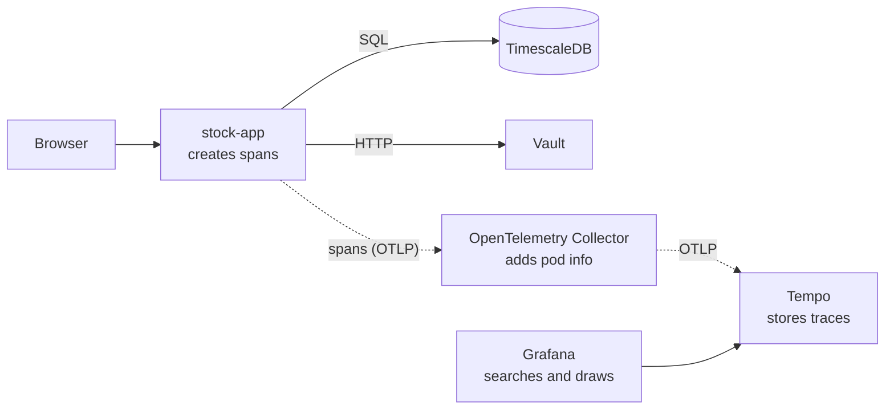

# Tracing

A metric tells you *that* requests are slow. A trace tells you *why*: it follows one request through everything
it touches and times each step.

## Three words

- **Trace:** the whole journey of one request, identified by a trace ID.
- **Span:** one step of that journey (handling the request, one SQL query, one call to another service), with a
  start time, a duration and some attributes. Spans nest: a query made while handling a request is its child.
- **Context propagation:** how the trace ID travels. Inside a process it is passed along automatically; between
  services it rides in the `traceparent` HTTP header, so the next service adds its spans to the same trace.

## One request on our cluster

stock-ui asks stock-app for MSFT prices it has never seen. Its trace, slightly simplified:

```text
GET /api/v1/instruments/{symbol}/bars  ██████████████████████████████  1440 ms   stock-app handles the request
  SELECT instruments                   ▏                                   1 ms   is MSFT cached? no
  yahoo fetch_instrument                ██████████████████████          1083 ms   ask Yahoo who MSFT is
  yahoo fetch_daily_bars                                      ██████     314 ms   ask Yahoo for the prices
  INSERT price_bars                                                 ▌     19 ms   cache them in TimescaleDB
```

Reading it takes seconds: three quarters of the time is Yahoo, the database is not the problem. Ask again and
the trace shrinks to a few fast `SELECT`s, because the prices are now cached.

## From the app to your screen



1. **Create:** while it serves a request, stock-app records spans with OpenTelemetry, the vendor-neutral standard.
2. **Export:** every few seconds it sends finished spans, in the standard OTLP format, to the Collector.
3. **Process:** the Collector adds which pod, deployment and node the spans came from, then forwards them.
4. **Store:** Tempo keeps traces and answers searches like "requests slower than 500 ms".
5. **Show:** Grafana queries Tempo and draws dashboards and the waterfall above.

In Kubernetes terms, the Collector and Tempo are ordinary Deployments with Services in the `monitoring` namespace.
stock-app finds the Collector through cluster DNS, and the address comes from an environment variable in its
Deployment, so pointing it somewhere else needs no code change.

## The OpenTelemetry Collector

A small service that sits between the apps and the storage. It runs a **pipeline** in three stages:

| Stage | What ours does |
|---|---|
| **Receivers** take data in | accept spans over OTLP |
| **Processors** change it | guard the Collector's memory; add pod, deployment, namespace and node names |
| **Exporters** send it on | forward to Tempo, queueing and retrying while Tempo is down |

Why put it in the middle instead of sending straight to Tempo:

- **Apps stay simple.** They only know "send to the Collector". Swapping Tempo for another backend, or sending to
  two, is a Collector config change; no app is redeployed.
- **One place for shared rules:** add Kubernetes metadata, drop sensitive attributes, or keep only slow and failed
  traces (*tail sampling*, which an app cannot do because it decides before the request ends).
- **It absorbs trouble.** If Tempo restarts, the Collector buffers and retries instead of each app.

Two common ways to run it in Kubernetes:

- **Gateway** (ours): one central Deployment that every app sends to.
- **Agent:** a DaemonSet, one Collector per node, that apps reach locally. Large clusters often use both: agents
  next to the apps, forwarding to a gateway.

To name the pod behind each span, the Collector looks up the sender's IP in the Kubernetes API. That needs
permission, so it gets a ServiceAccount with a **Role** that can only read pods in the `apps` namespace, which is
less than a cluster-wide ClusterRole would grant.

## Who creates the spans

- **Instrumentation libraries (automatic).** They plug into the libraries the app already uses: the web
  framework, the database driver, the HTTP client. Each incoming request, SQL query and outgoing call becomes a
  span with standard attribute names that every tracing tool understands. You do not write a span per query by
  hand: that would be repetitive, easy to forget and inconsistent.
- **Manual spans (by hand).** Only for work no library can see. In stock-app that is the call to Yahoo, whose
  HTTP client has no instrumentation library.

## Metrics, logs and traces together

| Signal | Answers | Example |
|---|---|---|
| Metrics | Is something wrong? | p95 latency jumped to 2 s |
| Traces | Where in the request? | the Yahoo call took 1.8 s |
| Logs | What exactly happened? | the error message |

They link up: each dot on the Stock App dashboard's latency chart (an *exemplar*) opens the trace of that
request, and every log line written during a request carries its trace ID.

## Good habits

- Let instrumentation libraries cover the edges (incoming requests, database, outgoing calls); add manual spans
  sparingly.
- Name spans by route (`/instruments/{symbol}/bars`), not by raw URL, so similar requests group together.
- Never put secrets or personal data in span attributes: traces are read by many people.
- Skip noise such as health checks and metric scrapes. When traffic grows, keep only a sample of traces (here
  we keep all of them).
- Keep tracing code out of business logic: it belongs at the edges of the app.

## Try it

1. Open http://stock-ui.localhost and chart a symbol you have not used before.
2. In Grafana, open the **Tracing** dashboard. After about 30 s the request appears under *Slow Requests*.
3. Click its trace ID to see the waterfall.
